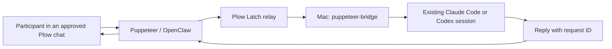

# Puppeteer

Let the people in an iMessage group talk to the Claude Code and Codex agents
already running in MyPlow on your Mac.

You text Puppeteer once to set it up. It installs a small connector on your Mac
through Latch, creates a group with the people you name, and prepares a fresh
coding workspace. From then on anyone in the group can start a message with
`/prompt` and get a real answer from a real coding agent, with their name and a
request ID on it:

```text
Alex: /prompt Make greet() say good morning before noon
Puppeteer: Alex · #a1234567
           Queued for a separate coding worker. I'll post its reply here when it arrives.
           Check again: /prompt status a1234567
Puppeteer: Alex · #a1234567
           coder replied:

           Changed greeting.py to pick the greeting from the hour.
           Ran python3 test_greeting.py: 2 tests passed.
```

Ordinary conversation in the group is ignored before any model or Mac
operation. Only messages that start with `/prompt` reach your Mac.

[Watch the demo](https://youtu.be/A6wRp-Ymw9U) ·
[Agent Index](https://aiworthusing.com/agent-index/puppeteer)

## What it will and won't do

It will:

- Forward a verified `/prompt` message, once, to the MyPlow session or workers
  you shared, and post the agent's actual reply back in the same group.
- Give each participant their own worker and Git worktree in parallel mode, so
  four people can work at once without editing the same checkout.
- Relay `/prompt ask owner …` questions to you privately, and send your answer
  back to that group.
- Pause, resume and report status when you ask in your private chat.

It won't:

- Run anything a guest types as a shell command, path or tool argument. The
  task text reaches the coding agent on stdin, fenced as participant data.
- Give a group, or you while you are in a group, any tool beyond the four
  coding and question tools. Setup and raw Mac tools exist only in your
  private chat with Puppeteer.
- Merge, push or publish the workers' changes. Their worktrees stay on your
  Mac for you to review.
- Resend anything whose delivery it could not confirm. It reports the
  uncertainty and lets you decide.
- Sandbox the coding agent. A worktree prevents edit collisions; the agent
  still has its usual permissions on your Mac. Share sessions you would let
  these people use.

## Install

You need, on the same Plow account:

- [MyPlow](https://github.com/delattre1/mypeople) installed and signed in on
  your Mac, with Claude Code or Codex as its backend.
- [Latch](https://plow.co/download/latch) open on that Mac, and the Mac awake.

Then:

1. Open [Puppeteer on the Agent Index](https://aiworthusing.com/agent-index/puppeteer)
   and tap **Text this agent**. Plow deploys Puppeteer on a free line of your
   account.
2. Text Puppeteer privately: `Set up Puppeteer on my Mac.`
3. Approve the connector install when Latch asks. Puppeteer installs the pinned
   MIT connector with `uv`, checks MyPlow, and offers the next step:

   > I found your MyPlow Boss. I can create an iMessage group and a fresh coding
   > workspace for it. Who should I add first?

4. Name the first person. Puppeteer looks for one exact match in your Contacts
   and asks for an iMessage number or email only when it cannot verify one. It
   creates the group, prepares a workspace with one commit and a passing test,
   connects four workers, and welcomes the group.

You don't copy IDs, prepare a repository or choose a worker count. To use an
existing group or project instead, name it in your private chat. You can add
more people in iMessage at any time.

No Mac terminal commands and no extra `plow-agents login` are needed. MyPlow
supplies `uv` and the runtime. The connector calls MyPlow's installed `mp`; it
reaches sessions MyPlow manages, not arbitrary Codex desktop tabs or unmanaged
terminals.

### Stop, revoke, upgrade

- **Pause:** text "Pause the demo". Queued work is cancelled and this demo's
  workers retire; worktrees stay. "Resume the demo" reopens the same group and
  workspace without replaying cancelled or uncertain tasks.
- **Check the connection:** "Check my Mac connection" runs a read-only check.
- **Revoke group access:** ask Puppeteer to share only with your private chat.
- **Revoke everything:** remove `~/.config/puppeteer/bridge.json` on the Mac.
  Running coding sessions and their worktrees are not touched.
- **Upgrade the connector:** text "Upgrade the Mac connector". A cloud image
  update does not change software already installed on your Mac.

Custom MyPlow homes can set `PUPPETEER_MAC_READ_PATHS` and
`PUPPETEER_MAC_WRITE_PATHS` (JSON arrays) in the cloud environment; include the
selected runtime directory in the write paths.

## Use it in a group

| Message | What happens |
| --- | --- |
| `/prompt` or `/prompt help` | A short usage reply. Nothing runs on the Mac. |
| `/prompt agents` | Lists the sessions shared with this group. |
| `/prompt TASK` | Sends the task once. The reply arrives in the group with your name and request ID. |
| `/prompt status ID` | Reads that request's current result. Never starts new work. |
| `/prompt status ID full` | The full reply when the first one was an excerpt. |
| `/prompt ask owner QUESTION` | Sends the question privately to the Mac owner. The group sees nothing until the owner answers. |

The command is case sensitive and must start the message. Normal chat,
`/promptfoo`, `/PROMPT`, quoted commands and leading spaces are ignored. The
eight-character ID from a reply is enough for `status`.

In parallel mode each request gets a fresh detached worktree from the project.
A participant's first task starts from the project as it is, including tracked
changes and untracked, non-ignored files. Their follow-ups continue from their
own last completed worktree, with their previous task and its reply as context.
Other people's work stays separate.

Limits, all enforced on the Mac:

- Up to the chosen number of workers (default four, at most eight) run at once.
- One participant has one running task per group; their next tasks wait.
- One participant can have at most three tasks waiting per group. The group
  holds up to 256 waiting tasks in total. Extra tasks get a plain refusal.
- Queued work expires after 15 minutes. The original message must be less than
  an hour old when it is verified.
- One owner question can be pending per group, for 48 hours, up to 500
  characters.

For a stage demo, use a group whose members and bot send and receive iMessage
in that same group. SMS replies can arrive as individual messages instead (see
[Apple's group messaging guidance](https://support.apple.com/en-us/118236)).

## Run the cloud agent locally

With Docker and [plow-agents](https://github.com/plow-pbc/plow-agents) installed:

```sh
git clone https://github.com/EnzoTironi/puppeteer.git
cd puppeteer
plow-agents login
plow-agents lines
plow-agents mint LINE_UID          # writes ./plow-credentials (git- and docker-ignored)
docker compose up --build -d
docker compose logs -f agent       # wait for "plow-boot: identity resolved"
```

Use a line `plow-agents lines` shows as free, then text its number:
`/prompt List the shared coding agents`. The dashboard is on loopback only, at
<http://localhost:3001> (`HOST_PORT=3002 docker compose up -d` to move it).

The image already sets `AGENT_ID=puppeteer`, so the inherited base reporter
registers this install and reports the cloud agent's OpenClaw usage every five
minutes. It never attributes local MyPlow usage to Puppeteer. Change `AGENT_ID`
if you fork it as a different agent. `docker compose down` keeps state;
`down -v` starts fresh.

On Apple Silicon, build the native `linux/arm64` image (`docker compose
build`). Emulated `linux/amd64` can fail OpenClaw's secure file locks with
`openat2 … ENOSYS`; do not disable those locks.

## Deploy and publish

```sh
plow-agents image build ghcr.io/YOU/puppeteer-openclaw:v1
plow-agents image push ghcr.io/YOU/puppeteer-openclaw:v1      # prints repo@sha256:…
plow-agents deploy ghcr.io/YOU/puppeteer-openclaw@sha256:DIGEST --line LINE_UID
```

Make the GHCR package public. For 1-click deploy from the Agent Index, give the
Plow admin your account UID (`plow-agents profile --show`), the slug
`puppeteer` and the digest printed by the push. After that, updates are
`plow-agents image push ghcr.io/YOU/puppeteer-openclaw:v2 --promote puppeteer`.

Listing media and copy are drafted in
[docs/agent-index/listing.md](docs/agent-index/listing.md). Register them with
the [agent-index-client](https://github.com/plow-pbc/agent-index-client), then
post the repo, commit and Agent Index ID in the verification thread.

## Advanced: manual connector setup

For custom deployments, install the same pinned connector yourself:

```sh
uv tool install 'git+https://github.com/EnzoTironi/puppeteer.git@6375e8021e6362ad7a7938cfff9d7e8e39c0c67f'
plow-agents login
puppeteer-bridge configure \
  --agent coder=YOUR-HOST/main:eng-codex \
  --chat cht_YOUR_CONVERSATION
```

Manual configuration verifies messages with the Mac's own Plow login
(`~/.config/plow/token`); it is never copied to the cloud. Pair through the
guided setup before using the cloud image's signed path.
`MYPEOPLE_CONFIG_PATH`, `MYPEOPLE_HOME`, `PUPPETEER_CONFIG`, `--token-file` and
`--api-base` support custom installs. `configure` replaces the whole grant list,
and revoking a grant also hides its stored replies. The connector refuses
`configure`, `demo`, `prepare`, `pair` and `stop` from inside a MyPlow agent
session (`AGENT_ID` set), so a coding agent cannot widen its own grants.

## How it works



Puppeteer is an OpenClaw variant of Plow's public base image. Plow Chat carries
the conversation, Latch reaches the Mac, and MyPlow's `mp send` reaches the
session. There is no custom relay and no inbound port on the Mac.

**Identity.** Puppeteer always introduces itself as Puppeteer, in English. The
phone line's display name (Alder, Oak, Spruce) is transport metadata.

**Verification.** A fixed router in the Plow channel handles group `/prompt`
messages before any model turn. The cloud side fetches the original message
with its own credential, checks the sender is a member of the group and the
text matches, and signs that record with a per-install pairing key. The Mac
checks the signature, conversation, sender, age and `/prompt` prefix again, then
passes the text to `mp send` on stdin inside a random fence the participant
cannot predict. Credentials and pairing keys never appear in tool results or
request ledgers.

**Delivery.** Each source message gets one request ID; concurrent retries do
not send twice. The coding agent answers through a callback authorized by a
private per-request key, of which only the hash is stored. The group router
posts the receipt, watches it, and posts the actual answer; free-form model
text never replaces a verified result. Only Latch's real `awaiting_approval`
state asks the owner to approve. Requests expire after 15 minutes.

**Recovery.** Receipts, group notifications and private questions are recorded
as sending before any network call. After a restart the gateway resumes
watching, and a native OpenClaw command job (`puppeteer-recover`) reconciles
unfinished receipts every five minutes with no model turn. An uncertain send
is never repeated automatically; `/prompt status ID` reads the stored result.

**Setup gate.** Before each owner turn in the private chat, the startup plugin
injects the confirmed setup state, so old chat history cannot reset or fake
setup. Tools still require the current authenticated message.

**Boot.** `boot/preboot.ts` follows the base `boot/main.ts` step for step
(credential rotation, config rendering, gateway start, five-minute Agent Index
reporter), and adds the required Puppeteer plugin, a 60-second Mac relay
timeout and preserved model preferences. `scripts/customize-base.mjs` patches
the pinned Plow channel at exact anchors, and the build fails if an anchor
moves. See [docs/meetly-patterns.md](docs/meetly-patterns.md) for the patterns
adapted from Meetly and [checks/runtime-spike.md](checks/runtime-spike.md) for
runtime boundaries.

## Known limitations

- The coding agent is not sandboxed. It keeps its native permissions; the
  worktree only separates edits. Anyone in a shared group can ask it to do
  whatever that session can do.
- Group replies and fixed messages are English only.
- Every `/prompt` costs one Latch call before the Mac applies its limits. If
  your Latch policy asks before each command, a busy group means many prompts.
- Changes to `puppeteer_bridge/` reach Macs only after `PUPPETEER_BRIDGE_COMMIT`
  is bumped to a pushed commit and the owner upgrades the connector.
- A 100-participant simulated gateway test does not prove Apple supports a
  100-person physical iMessage group.
- A group watcher that stops on an unexpected error leaves the reply to the
  five-minute recovery job.

## Development

```sh
npm ci --ignore-scripts
npm test                  # plugin, router, store, prompt contract and pin tests (offline)
npm run typecheck         # fetches the pinned OpenClaw SDK types, checksum-verified
python3 -m unittest discover -s tests   # connector tests, Python 3.9+ (npm run test:bridge)
```

Tests need no network, Mac, credentials or MyPlow. They clear MyPlow and Plow
environment variables, so they pass inside a MyPlow pane. CI also builds the
image and runs the in-image tests: real OpenClaw tool discovery, group ingress,
a 100-person gateway rehearsal, the identity check and the preboot restart
test. Before a live demo, run [checks/manual-scenarios.md](checks/manual-scenarios.md)
on a real line, Mac and group.

**Bumping the base image:**

1. Pick a newer `base-<sha>` tag and its multi-arch index digest; update `FROM`.
2. Copy that commit's `boot/main.ts` to `tests/fixtures/base-main.ts.txt` and its
   `prompt/AGENTS.md` to `tests/fixtures/base-AGENTS.md`.
3. Bring `boot/preboot.ts` back in step with the new `main.ts`, update its first
   comment and `THIRD_PARTY.md` to the new commit.
4. Run `npm test`. The prompt test names any base sentence that changed.
5. Build the image; `customize-base.mjs` fails on any moved anchor.

**Releasing a connector change:** push the commit that changes
`puppeteer_bridge/`, set `PUPPETEER_BRIDGE_COMMIT` and the manual install line
above to that commit (a test keeps them equal), publish the image, and ask
owners to upgrade the connector.

Review rules are in [REVIEW.md](REVIEW.md).

## License

Puppeteer's code and persona are MIT licensed ([LICENSE](LICENSE)). The base
image keeps its third-party licenses, including the Apache-2.0 Plow base and
channel plugin. Patterns adapted from Meetly keep its MIT notice in
`licenses/Meetly-MIT.txt`. See [THIRD_PARTY.md](THIRD_PARTY.md). The image
contains no credentials.
