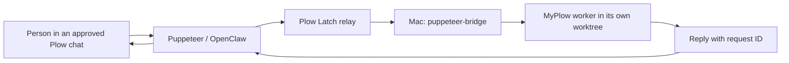

# Puppeteer

Your group chat gets a coding teammate. The people you add to an iMessage group
can ask the Claude Code and Codex agents already running in MyPlow on your Mac
to explain, fix and build. You see what they changed and keep what you want as
a branch.

Anyone in the group starts a message with "Puppeteer," and gets a real answer
from a real coding agent, with their name and a request ID on it:

```text
Alex: Puppeteer, make greet() say good morning before noon
Puppeteer: Alex · #a1234567
           Queued for a separate coding worker. I'll post its reply here when it arrives.
           Check again: /prompt status a1234567
Puppeteer: Alex · #a1234567
           coder replied:

           Changed greeting.py to pick the greeting from the hour.
           Ran python3 test_greeting.py: 2 tests passed.
```

Later, in your private chat with Puppeteer:

```text
You: What's waiting?
Puppeteer: #a1234567 Alex: "make greet() say good morning before noon", 2 files (+9 -2).
           Say "keep a1234567" to save it as a branch.
You: Keep a1234567
Puppeteer: Saved as branch puppeteer/a1234567 (commit 3f2c1d9e8b7a). Nothing was merged or pushed.
```

Ordinary conversation in the group never reaches a model or your Mac. Only
messages that start with "Puppeteer,", "Puppeteer:", "@Puppeteer" or `/prompt`
do.

[Watch the demo](https://youtu.be/A6wRp-Ymw9U) ·
[Agent Index](https://aiworthusing.com/agent-index/puppeteer)

## What it will and won't do

It will:

- Forward a verified request, once, to the MyPlow workers you shared, and post
  the agent's actual reply back in the same conversation.
- Give each person their own worker and Git worktree, so four people can work
  at once without editing the same checkout.
- Tell you, privately, what the group changed and who asked. It saves a change
  as a branch only when you say "keep".
- Relay "Puppeteer, ask owner …" questions to you privately, and send your
  answer back to that group.
- Pause, resume and report status when you ask in your private chat.

It won't:

- Run anything a guest types as a shell command, path or tool argument. The
  task text reaches the coding agent on stdin, fenced as participant data.
- Give a group, or you while you are in a group, any tool beyond the four
  coding and question tools. Setup, review and raw Mac tools exist only in
  your private chat with Puppeteer.
- Merge, push or publish anything. "Keep" writes one commit on a new branch
  and leaves your checkout alone.
- Resend anything whose delivery it could not confirm. It reports the
  uncertainty and lets you decide.
- Sandbox the coding agent. A worktree prevents edit collisions; the agent
  still has its usual permissions on your Mac. Share the workspace with people
  you would let use it.

## Install

You need, on the same Plow account:

- [MyPlow](https://github.com/delattre1/mypeople) installed and signed in on
  your Mac, with Claude Code or Codex as its backend.
- [Latch](https://plow.co/download/latch) open on that Mac, and the Mac awake.

Then:

1. Open [Puppeteer on the Agent Index](https://aiworthusing.com/agent-index/puppeteer)
   and tap **Text this agent**. Plow deploys Puppeteer on a free line of your
   account.
2. Text Puppeteer privately: `Set up Puppeteer on my Mac.`
3. Approve the connector install when Latch asks. Puppeteer installs the pinned
   MIT connector with `uv`, checks MyPlow, reuses your Boss (or creates one) and
   prepares a fresh coding workspace with one commit and a passing test. It
   asks you nothing else:

   > Your coding workspace is ready. Try it here: /prompt explain this project.
   > When you want your team in, tell me who to add.

4. Try it in that chat. In your private chat, `/prompt` sends a coding task and
   the reply arrives on its own; anything else you write is a conversation with
   Puppeteer.
5. When you're ready, name people: "Add Alex and Sam." Puppeteer looks for exact
   matches in your Contacts, asks for an iMessage number or email only when it
   cannot verify one, creates the group, shares the same workspace with it and
   welcomes them.

You don't copy IDs or choose a worker count. To use an existing group or one of
your own projects instead, name it in your private chat.

No Mac terminal commands and no extra `plow-agents login` are needed. MyPlow
supplies `uv` and the runtime. The connector calls MyPlow's installed `mp`; it
reaches sessions MyPlow manages, not arbitrary Codex desktop tabs or unmanaged
terminals.

### Stop, revoke, upgrade

- **Pause:** text "Pause the demo". Queued work is cancelled and this
  workspace's workers retire; worktrees stay. "Resume the demo" reopens the
  same group and workspace without replaying cancelled or uncertain tasks.
- **Check the connection:** "Check my Mac connection" runs a read-only check.
- **Revoke group access:** ask Puppeteer to share only with your private chat.
- **Revoke everything:** remove `~/.config/puppeteer/bridge.json` on the Mac.
  Running coding sessions and their worktrees are not touched.
- **Upgrade the connector:** text "Upgrade the Mac connector". A cloud image
  update does not change software already installed on your Mac. Name triggers
  ("Puppeteer, …"), the participant cap, the random fence and review need the
  upgraded connector; until then groups keep using `/prompt`.

Custom MyPlow homes and projects outside MyPlow's directory need
`PUPPETEER_MAC_READ_PATHS` and `PUPPETEER_MAC_WRITE_PATHS` (JSON arrays) in the
cloud environment. Include the selected runtime directory, and your project
when you want to keep its changes as branches.

## Use it in a group

| Message | What happens |
| --- | --- |
| `Puppeteer, TASK` | Sends the task once. The reply arrives in the group with your name and request ID. |
| `Puppeteer?` or `Puppeteer, help` | A short usage reply. Nothing runs on the Mac. |
| `Puppeteer, agents` | Lists the sessions shared with this group. |
| `Puppeteer, status ID` | Reads that request's current result. Never starts new work. |
| `Puppeteer, status ID full` | The full reply when the first one was an excerpt. |
| `Puppeteer, ask owner QUESTION` | Sends the question privately to the Mac owner. The group sees nothing until the owner answers. |

`Puppeteer:`, `@Puppeteer` and `/prompt` work in place of `Puppeteer,`. A
request has to start the message: "Hey Puppeteer, …", "Puppeteer is great",
leading spaces, `/PROMPT` and `/promptfoo` are ordinary chat and are ignored.
The eight-character ID from a reply is enough for `status`.

Each request gets a fresh detached worktree from the project. A person's first
task starts from the project as it is, including tracked changes and
untracked, non-ignored files. Their follow-ups continue from their own last
completed worktree, with their previous task and its reply as context. Other
people's work stays separate.

Limits, all enforced on the Mac:

- Up to the chosen number of workers (default four, at most eight) run at once.
- One person has one running task per group; their next tasks wait.
- One person can have at most three tasks waiting per group. The group holds up
  to 256 waiting tasks in total. Extra tasks get a plain refusal.
- Queued work expires after 15 minutes. The original message must be less than
  an hour old when it is verified.
- One owner question can be pending per group, for 48 hours, up to 500
  characters.

For a live demo, use a group whose members and bot send and receive iMessage
in that same group. SMS replies can arrive as individual messages instead (see
[Apple's group messaging guidance](https://support.apple.com/en-us/118236)).

## Review and keep

Ask Puppeteer privately "What's waiting?" It lists the group's finished tasks
whose worktrees hold changes, newest first:

- the ID;
- who asked;
- the task;
- the size: files and lines added and removed.

Say "keep ID" to save one as branch `puppeteer/ID` in the project. Then review
it with your usual tools, for example `git diff main...puppeteer/a1234567`, and
merge it if you like it.

Keeping writes one commit with Git plumbing: no hooks run, and your checkout,
index and HEAD don't move.

- Each worktree's starting state is recorded when it is created, so the commit
  holds only that worker's edits.
- If your project had uncommitted work when the task started, that work
  becomes a separate parent commit.
- Ignored files such as `.env` are never included.
- A person's later task builds on their earlier one, so their newest entry
  holds all of their work.

## Run the cloud agent locally

With Docker and [plow-agents](https://github.com/plow-pbc/plow-agents) installed:

```sh
git clone https://github.com/EnzoTironi/puppeteer.git
cd puppeteer
plow-agents login
plow-agents lines
plow-agents mint LINE_UID          # writes ./plow-credentials (git- and docker-ignored)
docker compose up --build -d
docker compose logs -f agent       # wait for "plow-boot: identity resolved"
```

Use a line `plow-agents lines` shows as free, then text its number:
`Set up Puppeteer on my Mac.` The dashboard is on loopback only, at
<http://localhost:3001> (`HOST_PORT=3002 docker compose up -d` to move it).

The image already sets `AGENT_ID=puppeteer`. The inherited base reporter
therefore registers this install and reports the cloud agent's OpenClaw usage
every five minutes. It never attributes local MyPlow usage to Puppeteer.
Change `AGENT_ID` if you fork it as a different agent. `docker compose down`
keeps state; `down -v` starts fresh.

On Apple Silicon, build the native `linux/arm64` image (`docker compose
build`). Emulated `linux/amd64` can fail OpenClaw's secure file locks with
`openat2 … ENOSYS`; do not disable those locks.

## Deploy and publish

```sh
plow-agents image build ghcr.io/YOU/puppeteer-openclaw:v1
plow-agents image push ghcr.io/YOU/puppeteer-openclaw:v1      # prints repo@sha256:…
plow-agents deploy ghcr.io/YOU/puppeteer-openclaw@sha256:DIGEST --line LINE_UID
```

Make the GHCR package public.

- **1-click deploy:** give the Plow admin your account UID (`plow-agents
  profile --show`), the slug `puppeteer` and the digest printed by the push.
- **Later updates:** `plow-agents image push ghcr.io/YOU/puppeteer-openclaw:v2 --promote puppeteer`.
- **Listing:** media and copy are drafted in
  [docs/agent-index/listing.md](docs/agent-index/listing.md). Register them
  with the [agent-index-client](https://github.com/plow-pbc/agent-index-client),
  then post the repo, commit and Agent Index ID in the verification thread.

## Advanced: manual connector setup

For custom deployments, install the same pinned connector yourself:

```sh
uv tool install 'git+https://github.com/EnzoTironi/puppeteer.git@6375e8021e6362ad7a7938cfff9d7e8e39c0c67f'
plow-agents login
puppeteer-bridge configure \
  --agent coder=YOUR-HOST/main:eng-codex \
  --chat cht_YOUR_CONVERSATION
```

Manual configuration verifies messages with the Mac's own Plow login
(`~/.config/plow/token`), which is never copied to the cloud. Pair through the
guided setup before using the cloud image's signed path.

- **Custom installs:** `MYPEOPLE_CONFIG_PATH`, `MYPEOPLE_HOME`,
  `PUPPETEER_CONFIG`, `--token-file` and `--api-base`.
- **Grants:** `configure` replaces the whole grant list. Revoking a grant also
  hides its stored replies.
- **Inside a MyPlow agent session** (`AGENT_ID` set), the connector refuses
  `configure`, `demo`, `prepare`, `pair`, `stop` and `keep`, so a coding agent
  cannot widen its own grants or save branches on its own.

## How it works



Puppeteer is an OpenClaw variant of Plow's public base image. Plow Chat carries
the conversation, Latch reaches the Mac, and MyPlow's `mp` reaches the
sessions. There is no custom relay and no inbound port on the Mac.

**Identity.** Puppeteer always introduces itself as Puppeteer, in English. The
phone line's display name (Alder, Oak, Spruce) is transport metadata.

**Verification.** A fixed router in the Plow channel handles requests before
any model turn: every group request, and the owner's `/prompt` in their DM.

- **Cloud:** fetches the original message with its own credential, checks that
  the sender belongs to the conversation and the text matches, and signs that
  record with a per-install pairing key.
- **Mac:** checks the signature, conversation, sender, age and trigger again.
  The cloud and the Mac read one trigger grammar, which
  `tests/fixtures/triggers.json` binds.
- **Hand-off:** the Mac passes the text to `mp send` on stdin, inside a random
  fence the participant cannot predict.
- **Secrets:** credentials and pairing keys never appear in tool results or
  request ledgers.

**Delivery.**

- Each source message gets one request ID; concurrent retries do not send twice.
- The coding agent answers through a callback authorized by a private
  per-request key. Only the key's hash is stored.
- The router posts the receipt, watches it, and posts the actual answer. A
  model's free text never replaces a verified result: when a request turn ran
  a coding tool, its final reply is the verified one.
- Only Latch's real `awaiting_approval` state asks the owner to approve.
- Requests expire after 15 minutes.

**Recovery.**

- Receipts, notifications and private questions are recorded as sending before
  any network call.
- After a restart the gateway resumes watching.
- A native OpenClaw command job (`puppeteer-recover`) reconciles unfinished
  receipts every five minutes, with no model turn.
- An uncertain send is never repeated automatically; `status ID` reads the
  stored result.

**Setup gate.** Before each owner turn in the private chat, the startup plugin
injects the confirmed setup state, so old chat history cannot reset or fake
setup. Tools still require the current authenticated message.

**Boot.** `boot/preboot.ts` follows the base `boot/main.ts` step for step:
credential rotation, config rendering, gateway start and the five-minute Agent
Index reporter. On top of that it adds:

- the required Puppeteer plugin;
- a 60-second Mac relay timeout;
- preserved model preferences.

`scripts/customize-base.mjs` patches the pinned Plow channel at exact anchors,
and the build fails if an anchor moves. See
[docs/meetly-patterns.md](docs/meetly-patterns.md) for the patterns adapted
from Meetly and [checks/runtime-spike.md](checks/runtime-spike.md) for runtime
boundaries.

## Known limitations

- **No sandbox.** The coding agent keeps its native permissions; the worktree
  only separates edits. Anyone in a shared group can ask it to do whatever that
  session can do.
- **English only.** Replies and fixed messages are in English.
- **One Latch call per request.** Every group request costs one Latch call
  before the Mac applies its limits. If your Latch policy asks before each
  command, a busy group means many prompts.
- **Connector upgrades.** Changes to `puppeteer_bridge/` reach Macs only after
  `PUPPETEER_BRIDGE_COMMIT` is bumped to a pushed commit and the owner upgrades
  the connector. Older connectors answer a "Puppeteer, …" request with a
  message to use `/prompt`.
- **Keep needs write access.** Keeping a change in a project outside MyPlow's
  directory needs that project in `PUPPETEER_MAC_WRITE_PATHS`. The default
  workspace is inside it.
- **Simulation is not iMessage.** A 100-participant simulated gateway test does
  not prove Apple supports a 100-person physical iMessage group.
- **Watchers can stop.** A group watcher that stops on an unexpected error
  leaves the reply to the five-minute recovery job.

## Development

```sh
npm ci --ignore-scripts
npm test                  # plugin, router, triggers, store, prompt contract and pins (offline)
npm run typecheck         # fetches the pinned OpenClaw SDK types, checksum-verified
python3 -m unittest discover -s tests   # connector tests, Python 3.9+ (npm run test:bridge)
npm run test:image        # the image's tests without Docker (first run downloads ~600 MB)
```

**What the tests need.** No Mac, credentials or MyPlow. They clear MyPlow and
Plow environment variables, so they pass inside a MyPlow pane.

**What `npm run test:image` does.** It rebuilds the image layout from the
pinned base commit (checked against the reviewed fixtures) and the pinned
OpenClaw package. It then runs the in-image tests against the real OpenClaw
runtime:

- tool discovery;
- group and owner-DM ingress;
- a 100-person gateway rehearsal;
- identity;
- preboot restarts.

**CI.** CI builds the real image and runs the same tests there. Before a live
demo, run [checks/manual-scenarios.md](checks/manual-scenarios.md) on a real
line, Mac and group.

**Bumping the base image:**

1. Pick a newer `base-<sha>` tag and its multi-arch index digest; update `FROM`.
2. Copy that commit's `boot/main.ts` to `tests/fixtures/base-main.ts.txt` and its
   `prompt/AGENTS.md` to `tests/fixtures/base-AGENTS.md`.
3. Bring `boot/preboot.ts` back in step with the new `main.ts`, and update its
   first comment and `THIRD_PARTY.md` to the new commit.
4. Run `npm test` and `npm run test:image`. The prompt test names any base
   sentence that changed.
5. Build the image; `customize-base.mjs` fails on any moved anchor.

**Releasing a connector change:**

1. Push the commit that changes `puppeteer_bridge/`.
2. Set `PUPPETEER_BRIDGE_COMMIT` and the manual install line above to that
   commit. A test keeps them equal.
3. Publish the image.
4. Ask owners to upgrade the connector.

Review rules are in [REVIEW.md](REVIEW.md).

## License

Puppeteer's code and persona are MIT licensed ([LICENSE](LICENSE)). The base
image keeps its third-party licenses, including the Apache-2.0 Plow base and
channel plugin. Patterns adapted from Meetly keep their MIT notice in
`licenses/Meetly-MIT.txt`. See [THIRD_PARTY.md](THIRD_PARTY.md). The image
contains no credentials.
